# Detekcija saobraćajnih traka (DOSiVuAV)

### Izveštaj / README

#### 1. Priložite izveštaj koji obuhvata sve tačke kriterijuma ocenjivanja i način na koji ste odgovorili na svaku od njih.

Upravo ga čitate! Svaka tačka kriterijuma je opisana u nastavku, zajedno sa lokacijom koda koji je implementira i
primerom rezultata. Sve slike su u [docs/](docs/).

- [src/pipeline.py](src/pipeline.py) je pipeline: svaki kadar prolazi kroz isti niz filtera, a klasa `LaneDetector`
  ih poziva redom.
- [main.py](main.py) prima sliku, folder sa slikama ili video i čuva rezultat.
- [src/make_docs.py](src/make_docs.py) ponovo pravi sve slike i video snimke u `docs/` koje koristi ovaj izveštaj.

```bash
python3 -m venv .venv
source .venv/bin/activate
pip install -r requirements.txt

python main.py sources/test_images/test1.jpg           # -> output_images/test1.jpg
python main.py sources/test_images/                    # sve slike u folderu
python main.py sources/test_videos/project_video03.mp4 # -> output_videos/project_video03.mp4
python src/make_docs.py                                # ponovo pravi sve slike i video snimke u docs/
```

Jedna razlika u odnosu na redosled iz šablona: perspektivna transformacija se radi **pre** pragovanja. Razlog je
objašnjen u tački 2 pipeline-a za pojedinačne slike.

### Kalibracija kamere

#### 1. Ukratko opišite kako ste izračunali matricu kamere i koeficijente distorzije. Priložite primer kalibracione slike sa ispravljenom distorzijom.

Kod je funkcija `calibrate` ([src/pipeline.py:64-86](src/pipeline.py#L64-L86)). Detektor je poziva jednom, a rezultat se
čuva u `sources/camera_cal/calib.npz`.

1. **Tačke objekta** ([src/pipeline.py:70-71](src/pipeline.py#L70-L71)): šahovska tabla ima 9x6 unutrašnjih uglova.
   Njihove koordinate na tabli su `(x, y, 0)` u mreži. Tabla je ravna (z = 0), pa se isti niz koristi za svaku sliku.
2. **Tačke slike** ([src/pipeline.py:75-80](src/pipeline.py#L75-L80)): `cv2.findChessboardCorners` traži uglove na sivoj
   slici, a `cv2.cornerSubPix` ih precizira na nivo ispod piksela. Uglovi su pronađeni na **17 od 20** slika. Na
   `calibration1.jpg`, `calibration4.jpg` i `calibration5.jpg` deo table je van kadra, pa se te slike preskaču.
3. **Kalibracija** ([src/pipeline.py:83](src/pipeline.py#L83)): `cv2.calibrateCamera` prilagođava pinhole model kamere
   (predavanje 09) svim parovima tačaka. Matrica kamere sadrži žižne daljine `fx, fy` i glavnu tačku `cx, cy`.
   Koeficijenti distorzije opisuju radijalnu (`k1, k2, k3`) i tangencijalnu (`p1, p2`) distorziju sočiva. RMS greška
   reprojekcije je **1,00 px**.

```
Matrica kamere:                        Koeficijenti distorzije (k1, k2, p1, p2, k3):
[[1156.46     0.00   671.32]           [-0.2467, -0.0254, -0.0007, 0.0001, 0.0107]
 [   0.00  1151.27   389.22]
 [   0.00     0.00     1.00]]
```

4. **Korekcija distorzije** ([src/pipeline.py:293-294](src/pipeline.py#L293-L294)): `cv2.undistort` se primenjuje samo na
   kadrove kalibrisane kamere (1280x720). Video snimci 960x540 su sa druge kamere, a za nju nema slika šahovske table.

Korekcija primenjena na `calibration1.jpg`. Ova slika nije korišćena za kalibraciju, pa je nezavisna provera: linije
table koje je radijalna distorzija iskrivila sada su prave.

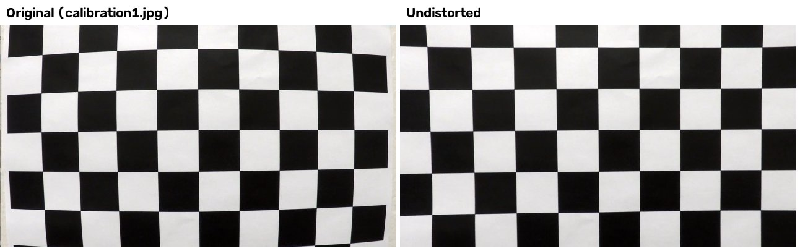

### Pipeline (pojedinačne slike)

#### 1. Priložite primer slike sa ispravljenom distorzijom.

Ista korekcija je prvi filter za svaki kadar. Na `test1.jpg` razlika se najviše vidi na ivicama slike: hauba na dnu
i belo vozilo desno menjaju oblik i položaj.

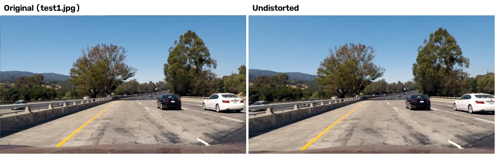

#### 2. Opišite kako (i navedite gde u kodu) ste koristili transformacije boja, gradijente ili druge metode za kreiranje binarne slike dobijene pragovanjem. Priložite primer dobijene binarne slike.

Kod je funkcija `binarize` ([src/pipeline.py:109-120](src/pipeline.py#L109-L120)), a njeni parametri su u
[src/pipeline.py:36-39](src/pipeline.py#L36-L39).

**Zašto pogled odozgo ide prvi.** Na pogledu odozgo (tačka 3) linija trake je svuda iste širine, 10-15 cm, što je
17-26 px, jer je jedan piksel poprečno na put 5,8 mm. Veličina filtera zato može da se izabere u centimetrima i radi
isto i kod vozila i 30 m ispred njega. Pored toga, sve iznad puta (nebo, drveće, druga vozila) više nije na slici.

Koraci:

1. **Gausov filter 5x5** uklanja šum (predavanje 02).
2. **BGR → LAB.** L je svetlina. b je plavo-žuta osa, na kojoj se žuta boja ističe i na suncu i u senci (prostori
   boja i filtriranje po boji, predavanja 00 i 06).
3. **Morfološki top-hat** (morfološko filtriranje, predavanje 06): `tophat = I - opening(I)`. Otvaranje (opening)
   horizontalnim kernelom 1x61 (35 cm) uklanja svaku svetlu strukturu užu od 35 cm. Razlika zato zadržava upravo te
   strukture: boju na putu. Široke svetle površine (svetao beton, belo vozilo) i tamne strukture (spojevi od katrana,
   senke, ivica između dve vrste asfalta) ne daju odziv. Odziv se meri u odnosu na lokalnu pozadinu, pa isti prag
   radi i na tamnom asfaltu i na svetlom betonu.
4. **Pragovanje**: piksel pripada liniji ako je top-hat kanala L veći od 30 (bela i žuta boja) **ili** je top-hat
   kanala b veći od 8 (žuta boja, i u senci, gde joj je svetlina mala).

Pragovi su podešeni na `test1-6.jpg`, `straight_lines1-2.jpg` i kadrovima iz svih šest snimaka. Na asfaltu boja
dostiže vrednosti 100-160 u top-hat-u kanala L, dok je na test slikama 95 % svih piksela pogleda odozgo ispod 21. Na
svetlom betonu kontrast je mnogo manji, i tu žutu liniju nalazi uglavnom sloj b.

Redovi ispod prikazuju `test5.jpg` (senke drveća na betonu), `test4.jpg` (prelaz sa betona na asfalt) i kadar iz
`challenge02.mp4` (spojevi od katrana pored linija). Kolone prikazuju pogled odozgo, oba top-hat odziva i konačnu
binarnu sliku:

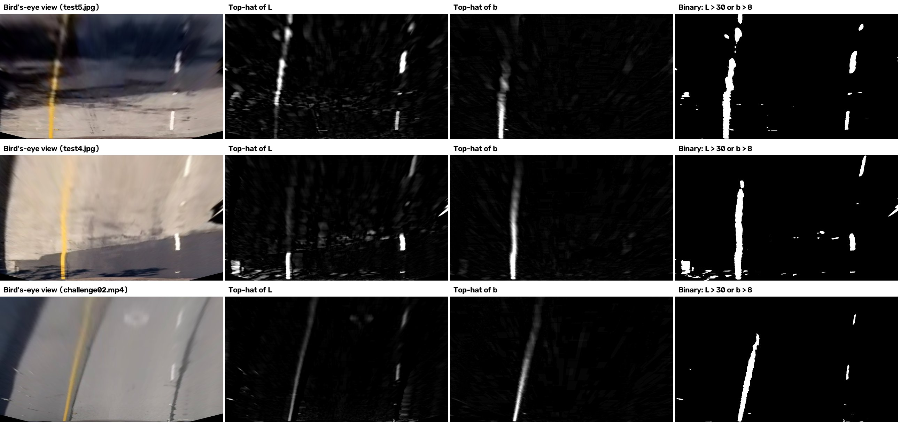

#### 3. Opišite kako (i navedite gde u kodu) ste izvršili perspektivnu transformaciju i priložite primer transformisane slike.

Kod je funkcija `perspective` ([src/pipeline.py:99-106](src/pipeline.py#L99-L106)), a opis kamere je u
[src/pipeline.py:18-34](src/pipeline.py#L18-L34). Koristi se u [src/pipeline.py:300-305](src/pipeline.py#L300-L305).

Trapez na putu se preslikava na pravougaonik fiksnog platna 1280x720 koje gleda odozgo (`cv2.getPerspectiveTransform`
i `cv2.warpPerspective`, predavanja 03 i 10). Na pravom putu stranice trapeza su linije trake, a one se seku u
**nedoglednoj tački** (vanishing point). Zato umesto četiri ručno izabrane tačke kameru opisujem njenom nedoglednom
tačkom i x koordinatama na kojima linije trake seku donji red slike. Stranice trapeza idu od tih donjih tačaka do
nedogledne tačke, a gornja ivica je na 13,5 % puta naniže od nedogledne tačke (red 460).

Merenje: na `straight_lines1.jpg` i `straight_lines2.jpg` bez distorzije fitovao sam pravu kroz piksele linija.
Rezultat je `x = -1,44 y + 1245` (leva) i `x = 1,55 y - 9` (desna), koje se seku u nedoglednoj tački **(641, 419)**.
U donjem redu linije su na x = 207 i x = 1107. Iz toga sledi:

| Izvor (slika) | Odredište (platno) |
|---|---|
| (582, 460) | (320, 0) |
| (704, 460) | (960, 0) |
| (1107, 720) | (960, 720) |
| (207, 720) | (320, 720) |

Provera: na `straight_lines1.jpg` obe linije su na platnu vertikalne i paralelne, a na `test2.jpg` se krivina vidi
kao dve paralelne krive.

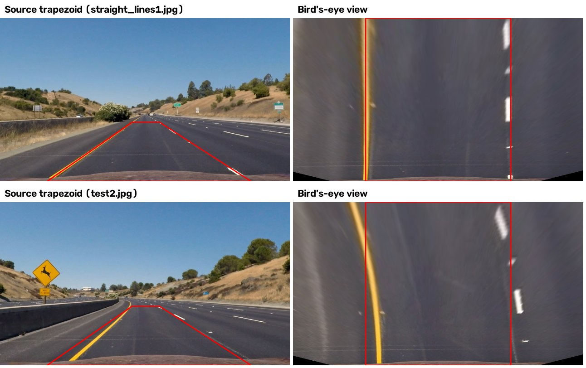

Kamera 960x540 (`project_video01-02.mp4` i slike `solid*`) ima svoj opis, izmeren na isti način na
`solidWhiteRight.jpg`: nedogledna tačka (478, 307) i donje tačke 150 i 850.

U videu se trapez dodatno prilagođava putu (oba prilagođavanja su opisana u sekciji o videu): red nedogledne tačke
prati nagib kamere, a u oštrim krivinama gornja ivica se spušta, pa platno prikazuje manje puta ispred vozila i
linije ne izlaze iz njega kroz stranice.

#### 4. Opišite kako (i navedite gde u kodu) ste identifikovali piksele linija trake i fitovali njihove pozicije polinomom.

Kod je `lane_starts` ([src/pipeline.py:123-137](src/pipeline.py#L123-L137)), `sliding_windows`
([src/pipeline.py:140-162](src/pipeline.py#L140-L162)), `around_fit` ([src/pipeline.py:165-181](src/pipeline.py#L165-L181)) i
`fit_line` ([src/pipeline.py:184-206](src/pipeline.py#L184-L206)). Pozivaju se u
[src/pipeline.py:307-311](src/pipeline.py#L307-L311), a parametri su u [src/pipeline.py:41-49](src/pipeline.py#L41-L49).

1. **Histogram** (histogram, predavanje 02; detekcija trake histogramom i kliznim prozorima, predavanje 10): kolone
   donje polovine binarne slike se sabiraju i zaglađuju. Dve linije počinju na paru kolona koji zajedno ima najviše
   piksela linija, ima vozilo između sebe i udaljen je za širinu trake (2,5-4,3 m, prednost imaju parovi blizu 3,7 m).
   Uzimanje najvišeg vrha sa svake strane ne radi kada je desna linija isprekidana, a na betonu pored nje postoji
   pukotina ili mrlja: na `test1.jpg` obe imaju približno isti broj piksela, i tek par na pravoj udaljenosti bira
   pravu liniju.
2. **Klizni prozori**: 9 prozora, visine 80 px i širine ±100 px, prati svaku liniju odozdo naviše. Prozor skuplja
   piksele u sebi, i ako ih ima više od 50, sledeći prozor se centrira na njihov srednji x. U prekidu isprekidane
   linije prozor nastavlja u pravcu poslednjeg koraka ([src/pipeline.py:157-160](src/pipeline.py#L157-L160)), pa ne gubi
   isprekidanu liniju u krivini.
3. **Fit metodom RANSAC** (predavanje 04): model je polinom drugog reda `x = Ay² + By + C`. x je funkcija od y jer
   su linije skoro vertikalne, a kao funkcija od x ne bi imale jednu vrednost. U svakoj od 250 iteracija (broj iz
   predavanja 04) bira se po jedan piksel iz svake trećine linije, sortirane po y, i kroz te tri tačke se provlači
   parabola. Piksel na manje od 30 px od parabole je inlier. Pobeđuje parabola sa najviše inliera, a konačni fit je
   metoda najmanjih kvadrata (`np.polyfit`) samo na njenim inlierima. Svih 250 parabola se računa odjednom pomoću
   numpy-ja, pa to košta otprilike koliko i jedan fit najmanjim kvadratima.
4. **Da li je to uopšte linija?** Linija trake je tanka, pa skoro svi pikseli oko nje leže na njoj: na
   `project_video03.mp4`, `challenge01.mp4` i `challenge02.mp4` najmanje 94 % piksela svake linije su inlieri.
   Sunčeve mrlje i lišće umesto toga popunjavaju ceo prozor. Ako je inliera manje od 60 %, u tom kadru nema linije
   (na `challenge03.mp4` takve odbačene „linije“ imaju medijanu od 44 % inliera). Liniji treba i najmanje 300 piksela.
5. **Sledeći kadar videa** (`around_fit`): prozori širine ±60 px idu odozdo naviše duž prethodnih polinoma. Svaki
   prozor se pomera u stranu onoliko koliko su se pikseli linije u prozoru ispod udaljili od prethodnog polinoma, pa se
   prati i linija koja počne da se savija više nego u prethodnom kadru. Fiksni pojas ±60 px oko prethodnog polinoma
   gubio je takve linije na početku krivine (`challenge03.mp4`, kadrovi 210-240): u pojasu je ostajao samo donji deo
   linija, a gornji deo fita je nastavljao pravo kroz šum. Posle odbačenog kadra ponovo se koriste klizni prozori.

Levo su prozori (zeleno) na `test3.jpg`, sa pikselima leve linije u crvenoj, desne u plavoj boji i polinomima u žutoj.
Desno je pojas pretrage oko prethodnog fita:

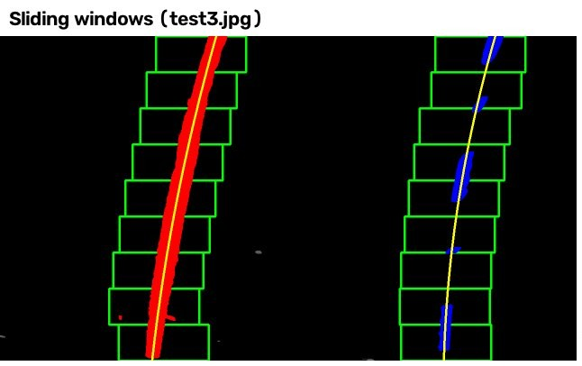

Zašto RANSAC, a ne samo najmanji kvadrati: na ovom kadru iz `challenge03.mp4` desni prozor je pokupio deo šuma pored
linije. Najmanji kvadrati savijaju parabolu prema svakom pikselu, dok RANSAC drži krivu na pikselima koji zaista leže
duž jedne parabole:

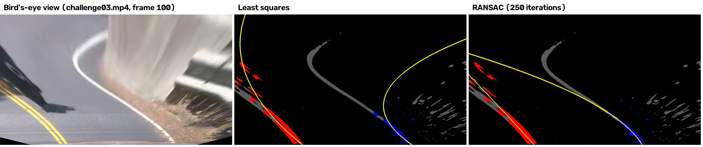

#### 5. Opišite kako (i navedite gde u kodu) ste izračunali poluprečnik zakrivljenosti trake i poziciju vozila u odnosu na centar.

Kod je `curvature` ([src/pipeline.py:237-245](src/pipeline.py#L237-L245)) i `curvature_and_offset`
([src/pipeline.py:248-253](src/pipeline.py#L248-L253)), razmera je u
[src/pipeline.py:28-29](src/pipeline.py#L28-L29) i `ym_per_px` ([src/pipeline.py:94-96](src/pipeline.py#L94-L96)), a položaj vozila
u [src/pipeline.py:307](src/pipeline.py#L307).

**Pikseli u metre.**

- Poprečno na put: traka je široka 3,7 m (američki standard, 12 stopa) i 640 px na platnu, pa je 1 px = 5,8 mm.
- Duž puta, razmera sledi iz kalibracije (pinhole model, predavanje 09). Tačka na putu u redu slike y je na
  udaljenosti `Z = h·fy / (y - y_vp)`, gde je h visina kamere, a `y_vp = 419` red nedogledne tačke. U donjem redu traka
  je široka 900 px, pa je `900 = 3,7·fx / Z`, odakle je `Z = 4,75 m` i h = 1,24 m. Gornja ivica trapeza je na 13,5 %
  puta naniže od nedogledne tačke, pa je udaljena `4,75 / 0,135 = 35,2 m`. Platno zato prikazuje **30,5 m** puta, i
  1 px = 4,2 cm. Trapez je pravougaonik na putu, pa je platno umanjeni pogled odozgo i ova razmera je ista svuda na
  njemu. Kada se platno u oštroj krivini skrati, `ym_per_px` na isti način daje razmeru za novu gornju ivicu.
- Nezavisna provera: na platnu se isprekidana linija ponavlja na svakih 338-365 px, što je 14,1-15,2 m. Na
  autoputevima u Kaliforniji crta je duga 12 stopa, a razmak 36 stopa, što je ukupno 14,6 m.

**Poluprečnik krivine.** Polinom se prevodi u metre sa `A_m = A·xm/ym²` i `B_m = B·xm/ym`. Njegova krivina je
`κ = 2·A_m / (1 + (2·A_m·y + B_m)²)^1.5`, računa se u donjem redu, kod vozila, a poluprečnik je `R = 1/|κ|`. Računa se za središnju liniju trake
(srednja vrednost levog i desnog polinoma), što daje jednu vrednost sa manje šuma nego bilo koja od linija.

**Položaj vozila.** Kamera je na sredini vozila, pa je vozilo na sredini donjeg reda slike. Njegov položaj na platnu
se dobija transformacijom te tačke istom matricom: x = 628, a ne 640, jer trapez nije potpuno simetričan. Pomeraj je
`(car_x - centar trake na dnu) · xm`, pozitivan udesno.

Rezultati na test slikama (izlaz komande `python main.py sources/test_images/`):

| Slika | Poluprečnik krivine | Pomeraj vozila |
|---|---|---|
| test1.jpg | 853 m | 0,26 m levo |
| test2.jpg | 557 m | 0,35 m levo |
| test3.jpg | 1030 m | 0,19 m levo |
| test4.jpg | 939 m | 0,38 m levo |
| test5.jpg | 787 m | 0,06 m levo |
| test6.jpg | 959 m | 0,34 m levo |
| straight_lines1.jpg | 17,5 km (pravo) | 0,07 m levo |
| straight_lines2.jpg | 7,3 km (pravo) | 0,09 m levo |

Kroz ceo `project_video03.mp4` poluprečnik je u krivinama uglavnom 740-1350 m (medijana 1000 m u prvoj krivini, za
koju Udacity materijal iz kog snimak potiče navodi otprilike 1 km), a na pravom delu između otprilike 12. i 25. sekunde
prelazi 5 km. Vozilo se kreće 0-0,55 m levo od centra trake:

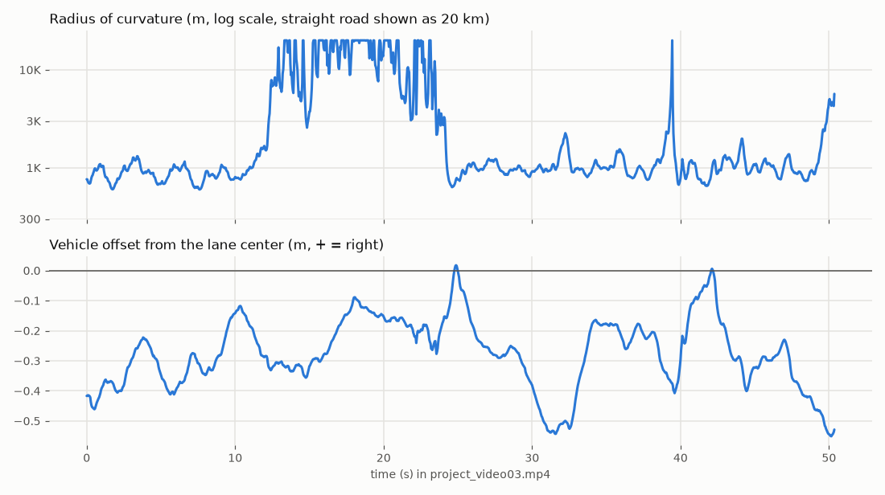

#### 6. Priložite primer slike sa rezultatom iscrtanim nazad na put, tako da je oblast trake jasno označena.

Kod je `draw_lane` ([src/pipeline.py:256-273](src/pipeline.py#L256-L273)). Na praznom platnu oblast između dva polinoma se
boji zeleno, a obe linije se crtaju duž polinoma kao debele crvene krive. Platno se inverznom matricom `Minv` vraća
na kadar i meša sa njim pomoću `cv2.addWeighted`. Poluprečnik i pomeraj se ispisuju u gornjem levom uglu.

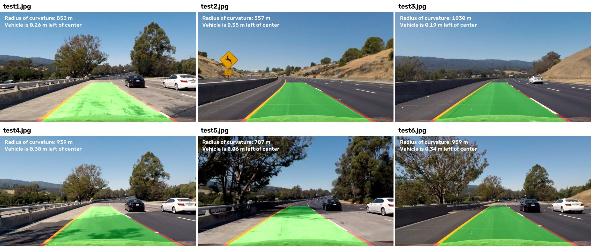

### Pipeline (video)

#### 1. Priložite link ka svom finalnom izlaznom videu. Vaš pipeline treba da radi prihvatljivo dobro na celom projektnom videu (blago treperenje linija je u redu, ali bez katastrofalnih grešaka koje bi dovele do toga da automobil sleti sa puta!).

**Glavni video: [docs/project_video03.mp4](docs/project_video03.mp4)**

Obrađeno je svih šest snimaka (`python src/make_docs.py`, ili `python main.py <video>` za jedan snimak):

| Video | Kamera | Kadrova | Kadrova sa trakom | Napomena |
|---|---|---|---|---|
| [project_video01.mp4](docs/project_video01.mp4) | 960x540 | 221 | 221 | nijedan odbačen kadar |
| [project_video02.mp4](docs/project_video02.mp4) | 960x540 | 681 | 681 | nijedan odbačen kadar |
| [project_video03.mp4](docs/project_video03.mp4) | 1280x720 | 1260 | 1260 | nijedan odbačen kadar |
| [challenge01.mp4](docs/challenge01.mp4) | 1280x720 | 251 | 251 | nijedan odbačen kadar |
| [challenge02.mp4](docs/challenge02.mp4) | 1280x720 | 484 | 484 | 2 odbačena kadra, zadržana je prethodna traka |
| [challenge03.mp4](docs/challenge03.mp4) | 1280x720 | 1199 | 1096 (91 %) | nema trake u gustoj izmaglici (kadrovi 876-892, 0,7 s) i u drugoj ukosnici (kadrovi 1023-1108, 3,4 s), videti diskusiju |

Na procesoru laptopa glavni video se obrađuje brzinom od oko 34 kadra u sekundi, što je brže od realnog vremena
(25 kadrova u sekundi).

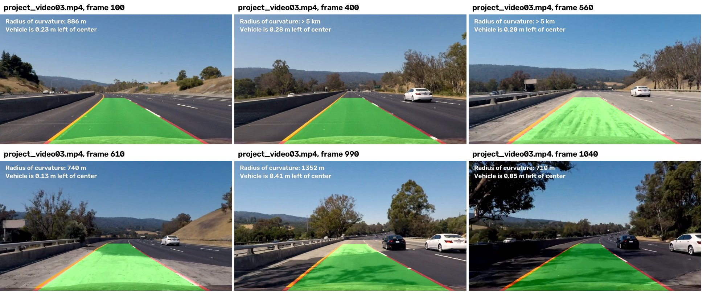

Ono što video dodaje pipeline-u za pojedinačne slike je funkcija `update`
([src/pipeline.py:318-348](src/pipeline.py#L318-L348)) sa proverama u `plausible`
([src/pipeline.py:350-360](src/pipeline.py#L350-L360)), i prilagođavanje platna u
[src/pipeline.py:298-304](src/pipeline.py#L298-L304). Parametri su u [src/pipeline.py:51-61](src/pipeline.py#L51-L61).

1. **Praćenje**: pikseli linija se traže oko prethodnih polinoma (tačka 4 iznad).
2. **Provera ispravnosti**: novi par linija se prihvata samo ako liči na traku:
   - traka kod vozila je široka 2,5-4,3 m (na pet snimaka koji rade u potpunosti izmerena širina je najviše
     4,12 m),
   - širina, merena poprečno na traku, menja se duž platna za manje od 2,5 m,
   - širina kod vozila se u odnosu na prethodni kadar menja za manje od 0,5 m,
   - vozilo je u traci (pomeraj manji od 1,2 m),
   - obe linije se savijaju slično: njihove krivine `κ` (formula u tački 5 iznad) razlikuju se za manje od
     0,01 1/m. Ovde je bitna cela formula. Poređenje samo koeficijenta `A` bilo bi pogrešno u oštrim krivinama, gde
     linije idu dijagonalno preko platna: tamo dve paralelne linije imaju različito `A`, pa su dobri parovi bili
     odbijani.

   Odbačen kadar zadržava prethodnu traku, a sledeći kadar ponovo koristi klizne prozore. Posle 10 odbačenih kadrova
   zaredom traka se odbacuje.
3. **Jedna dobra linija** ([src/pipeline.py:324-329](src/pipeline.py#L324-L329)): ako par ne prođe proveru ili jedna linija
   nedostaje (prekid isprekidane linije, izbledela boja, vozilo preko linije), zadržava se linija sa više piksela, a
   druga se crta paralelno sa njom, na poslednjoj poznatoj širini trake. „Paralelno“ se meri duž normale na krivu
   (`parallel`, [src/pipeline.py:217-222](src/pipeline.py#L217-L222)), a ne prostim pomeranjem u stranu, što je bitno u
   oštrim krivinama.
4. **Usrednjavanje**: eksponencijalni pokretni prosek koeficijenata polinoma, sa težinom 0,25 za novi kadar. Uklanja
   treperenje između kadrova i jednostavniji je srodnik Kalmanovog filtera iz predavanja 07.
5. **Nagib kamere** ([src/pipeline.py:340-343](src/pipeline.py#L340-L343)): na tačnom pogledu odozgo linije trake su
   paralelne. Ako se skupljaju (gore su uže nego kod vozila), nedogledna tačka je niže nego što je pretpostavljeno, pa
   se u svakom kadru pomera 0,5 px naniže po metru razlike, a obrnuto ako se šire. To se radi samo na blagim
   krivinama (poluprečnik veći od 500 m), gde parabola dobro opisuje linije, a nedogledna tačka ostaje u granicama
   ±30 px od izmerene. Na `project_video03.mp4` ostaje u redovima 415-424 (izmereno je 419). Na `challenge02.mp4` se
   za oko 7 s pomeri sa 419 na 435-443, što se slaže sa nedoglednom tačkom koja se vidi na njegovim kadrovima (oko
   445). Posle toga se širina trake duž njegovog platna menja za medijanu od samo 0,15 m. Bez ovog koraka linije se
   tamo skupljaju (medijana promene 1,35 m), platno nije pravi pogled odozgo i poluprečnik je potcenjen (medijana
   647 m umesto 1068 m).
6. **Domet pogleda koji se prilagođava krivini** ([src/pipeline.py:298-304](src/pipeline.py#L298-L304), `look_ahead`
   [src/pipeline.py:89-91](src/pipeline.py#L89-L91)): u ukosnici linije izlaze iz platna od 30 m kroz njegove stranice. Zato
   gornja ivica trapeza zavisi od poluprečnika iz prethodnog kadra: 30 m puta za poluprečnike iznad 300 m, sve manje,
   do oko 11 m pri poluprečniku od 30 m. Menja se polako (najviše 0,005 po kadru), a prethodni polinomi se prenose na
   novo platno preko homografije `M_novo · Minv_staro` (`remap`, [src/pipeline.py:209-214](src/pipeline.py#L209-L214)), pa
   se praćenje nastavlja bez skoka. Na prvih pet snimaka platno uvek ostaje na 30,5 m, pa tu ovo ništa ne menja. Na
   `challenge03.mp4` je kraće na 900 od 1199 kadrova, do najmanje 11,1 m.

Kadrovi iz ostalih snimaka. Poslednji kadar prikazuje grešku na `challenge03.mp4` u drugoj ukosnici:

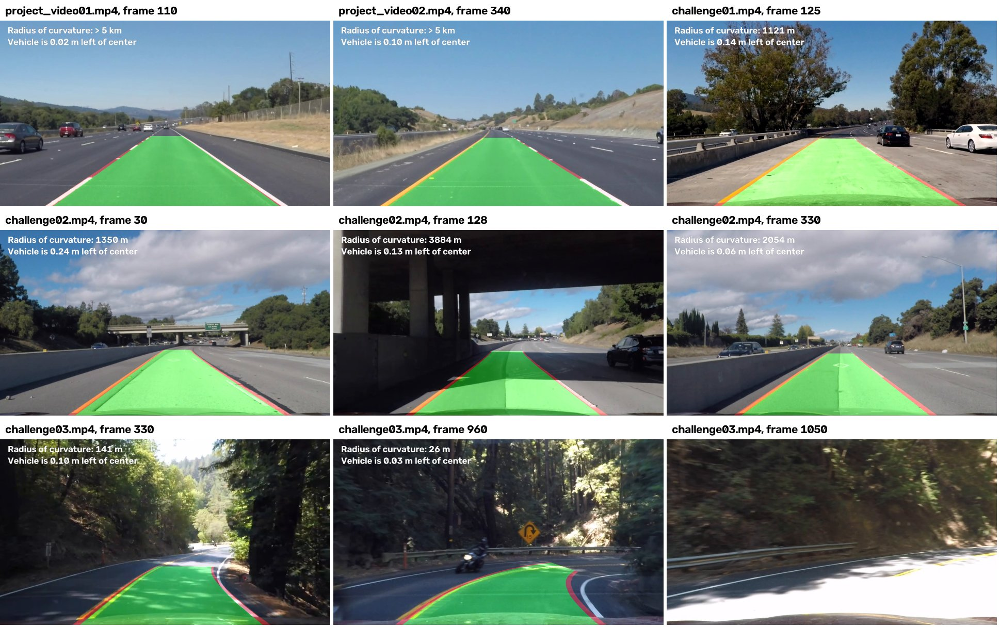

### Diskusija

#### 1. Ukratko prodiskutujte probleme / poteškoće sa kojima ste se suočili tokom implementacije ovog projekta. Gde će vaš pipeline verovatno otkazati? Šta biste mogli da uradite da ga učinite robusnijim?

**Problemi i kako sam ih rešio**

1. **Gradijenti su nalazili previše.** Prva verzija je kombinovala Sobel x, pravac gradijenta i pragove u HLS
   prostoru. Radila je na projektnom videu, ali je na `challenge02.mp4` Sobel nalazio i spojeve od katrana, ivicu
   između dve vrste asfalta i senku ograde, jer su sve to jake vertikalne ivice. Linija trake nije samo ivica, nego
   uska svetla traka, a to je upravo ono što nalazi morfološki top-hat:

   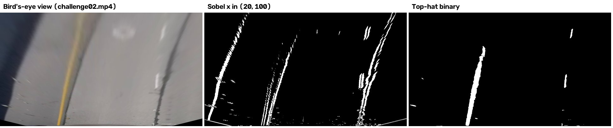

2. **Ručno izabran trapez i pretpostavljena razmera.** Umesto četiri pretpostavljene tačke izmerio sam nedoglednu
   tačku, a metri po pikselu duž puta slede iz kalibracije umesto iz pretpostavke. Isprekidana linija potvrđuje
   rezultat.
3. **Nagib kamere nije stalan.** Sa fiksnim trapezom linije na `challenge02.mp4` su se na platnu skupljale. Moja prva
   provera ispravnosti je zahtevala paralelne linije i odbacila je 391 od 484 kadra. Procena nedogledne tačke tokom
   praćenja (video, tačka 5) je to rešila.
4. **Planinski put** (`challenge03.mp4`). Prva verzija je iscrtavala traku na samo 79 % kadrova, i deo njih je bio
   pogrešan. Za svaki kadar sam merio koja provera pada i zašto, i dodavao izmene jednu po jednu, svaku proveravajući
   na svih šest snimaka da ostali ne bi postali gori: RANSAC sa udelom inliera, pretraga para za početke linija, domet
   pogleda koji se prilagođava krivini, dodatne provere ispravnosti i paralelna linija merena duž normale. Zatim sam
   pregledao svaki 10. kadar sva tri challenge snimka i našao tri preostale greške:
   - na početku krivine (kadrovi 210-240 i 280-290) desna linija je bila iscrtana na travi pored puta, jer je fiksni
     pojas pretrage gubio liniju koja se savija. Ispravljeno prozorima duž prethodnog fita (tačka 5 pretrage linija);
   - u gustoj izmaglici (kadrovi 880-905) ivica ograde je uzimana za desnu liniju, pa je traka klizila sa puta. Sa
     novim praćenjem to se više ne dešava: ti kadrovi nemaju traku umesto pogrešne;
   - u ukosnicama su dobri parovi bili odbijani, jer je provera poredila samo koeficijent `A` umesto prave krivine
     (video, tačka 2).

   Sada je traka iscrtana na 91 % kadrova. Kao meru pogrešnih traka brojao sam kadrove van druge ukosnice u kojima bi
   vozilo bilo više od 0,8 m od centra trake: bilo ih je 11, a sada ih nema. Bez RANSAC-a (sa običnim najmanjim
   kvadratima) bilo bi ih 16, a sa fiksnim platnom od 30 m ne bi ih bilo, ali bi traka bila iscrtana na manje kadrova
   (1058 umesto 1096). U ukosnici je takav pomeraj stvaran: vozač seče krivinu blizu središnje linije.
5. **Dve različite kamere.** Za snimke 960x540 nema slika šahovske table, pa se kod njih ne radi korekcija distorzije
   i imaju svoj trapez. Njihovi metri su samo približni, jer visina i žižna daljina te kamere nisu poznate, pa je
   pretpostavljena ista razmera.
6. **Ponovljivi rezultati.** RANSAC bira slučajne uzorke. Svaki detektor ima svoj generator slučajnih brojeva sa
   fiksnim početnim stanjem (seed), pa ista slika ili isti video uvek daju potpuno isti rezultat.

**Gde pipeline otkazuje**

- **Druga ukosnica na `challenge03.mp4`** (kadrovi 1023-1108). Put skreće za skoro 180°, pa je traka ispred vozila
  van slike, a kamera vidi uglavnom suprotnu traku i ogradu. Jako sunce i zamućena slika brišu belu liniju, a tamo gde
  su obe linije nađene, one izlaze iz platna kroz njegovu stranu: parabola `x = f(y)` ne može da prati put koji skreće
  u stranu, pa se dve krive van vidljivog dela razilaze. Provere odbacuju ove kadrove, pa se umesto pogrešne trake ne
  crta nikakva.
- **Gusta izmaglica** (kadrovi 876-892 na `challenge03.mp4`): žuta linija skoro nestaje, pa nema dovoljno piksela
  linije, a jedina svetla traka desno je ivica ograde.
- **Promena trake**: praćenje prati stare linije dok ih provera ispravnosti ne odbaci.
- **Noć, kiša, sneg, izbledela boja**, i svetli uski objekti tik uz liniju.
- **Usponi i padovi**: pogled odozgo pretpostavlja ravan put. Procena nagiba to nadoknađuje samo delimično.

**Kako ga učiniti robusnijim**

- **Kalmanov filter** umesto pokretnog proseka (predavanje 07). Modeluje koliko brzo se traka menja i govori koliko je
  procena pouzdana, pa bi provere mogle da zavise od te pouzdanosti.
- **Bogatiji model trake**: parabola ne može da opiše S-krivinu ili ukosnicu. Splajn, klotoida ili 3D model puta
  pratili bi takve puteve.
- **Automatska početna nedogledna tačka** za nepoznatu kameru, iz Hafove transformacije linija trake na prvim
  kadrovima (predavanje 04).
- **Korišćenje i ostalih linija** (suprotna traka, ivica puta): kada jedna linija moje trake nije vidljiva, njihova
  udaljenost bi i dalje govorila gde je.
- **Upozorenje o napuštanju trake** na osnovu izmerenog pomeraja (predavanje 10).
